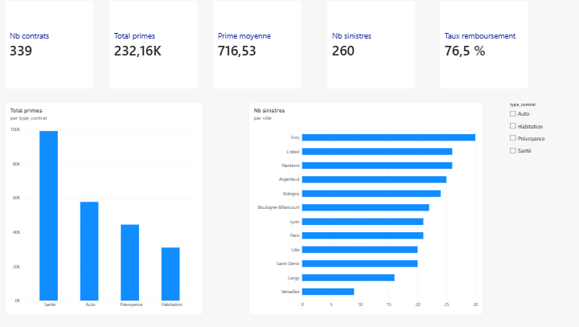

# Leçon Power BI 1 — Premier tableau de bord d'un portefeuille d'assurance

| Élément | Détail |
|---|---|
| **Auteure** | Géneviève AMAGBEGNON |
| **Date** | 18/11/2026 |
| **Données** | `clients.csv`, `contrats.csv`, `sinistres.csv` (données fictives, export de `assurance_entrainement.db`) |
| **Notions** | import CSV, Power Query (types), modèle de données, relations 1 → plusieurs, mesures DAX, visuels, segment |
| **Outil** | Power BI Desktop |
| **Fichier** | `pbi_s1_j1.pbix` |

**Objectif :** construire un tableau de bord de suivi d'un portefeuille d'assurance (contrats, primes, sinistres) et retrouver dans Power BI les indicateurs calculés en SQL et en Python.



## Modèle de données

```
clients (1) ──── (*) contrats (1) ──── (*) sinistres
   id_client          id_client
                      id_contrat           id_contrat
```

- Un client peut avoir plusieurs contrats ; un contrat peut avoir plusieurs sinistres.
- Le filtrage descend de `clients` vers `contrats`, puis vers `sinistres` : un filtre sur la ville s'applique donc aussi aux contrats et aux sinistres.

## Mesures DAX

| Mesure | Formule | Résultat (sans filtre) |
|---|---|---|
| Nb contrats | `COUNTROWS(contrats)` | 339 |
| Total primes | `SUM(contrats[prime_annuelle])` | 232 156,49 € |
| Prime moyenne | `AVERAGE(contrats[prime_annuelle])` | 716,53 € |
| Nb sinistres | `COUNTROWS(sinistres)` | 260 |
| Taux remboursement | voir ci-dessous | 76,5 % |

```DAX
Taux remboursement =
DIVIDE(
    CALCULATE(SUM(sinistres[montant_rembourse]), sinistres[statut] = "Clos"),
    CALCULATE(SUM(sinistres[montant_declare]),   sinistres[statut] = "Clos")
)
```

- `CALCULATE` applique un filtre supplémentaire (ici, les sinistres clos) au calcul.
- `DIVIDE` gère la division par zéro, contrairement à l'opérateur `/`.

## Page « Vue d'ensemble »

| Visuel | Contenu | Constat |
|---|---|---|
| 5 cartes | les 5 mesures ci-dessus | portefeuille de 339 contrats, 76,5 % des montants déclarés remboursés |
| Histogramme groupé | Total primes par type de contrat | la Santé porte le plus de primes (99 084,93 €) |
| Graphique à barres | Nb sinistres par ville | Évry déclare le plus de sinistres (30) |
| Segment | type de contrat | filtre toute la page |

## Cohérence avec SQL et Python

Les mêmes indicateurs ont été calculés dans `sql/s1_j2.sql`, `sql/s1_j3.sql` et `python/py_s1_j1.ipynb` : les trois outils donnent des résultats identiques.
